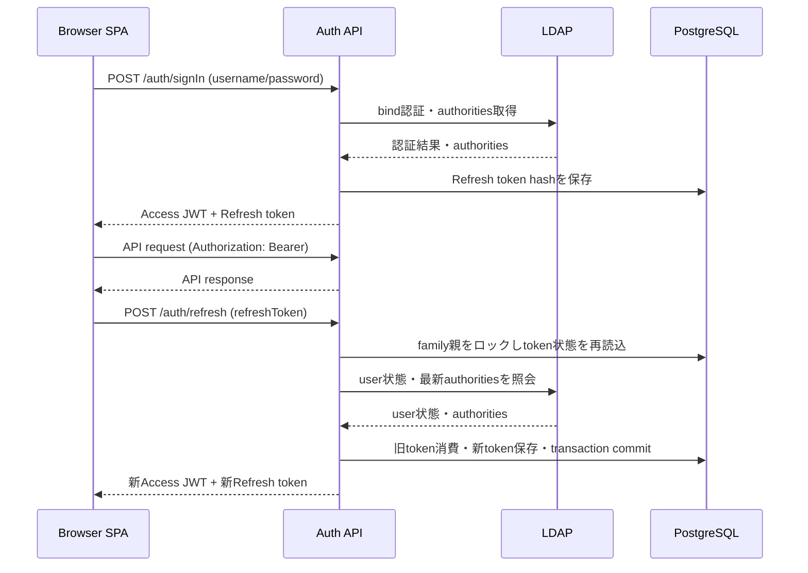

# LDAPログインAPI Refresh Token 要件定義・詳細設計

- 作成日: 2026-10-20
- 文書状態: 初版。要確認事項を確定後、実装前に更新する
- 対象: `api` モジュールの認証APIと、それを利用するブラウザフロントエンド

## 1. 目的

LDAPログイン後に発行するAccess tokenの有効期間が切れた際、ユーザーに再入力を求めずに認証を継続できるようにする。Refresh tokenをサーバー側で管理し、ログアウト、tokenローテーション、再利用検知を可能にする。

## 2. 現行構成

- `POST /auth/signIn` がLDAPのユーザー名・パスワードを認証し、JWTを1つ発行する。
- 成功レスポンスは `token`、`username`、`authorities` を持つ。既存クライアントとの互換性のため、このフィールド名と意味を維持する。
- JWTにはissuer、subject、issued-at、expires-at、JWT ID、authoritiesが含まれる。
- Composeの `APP.JWT.TTL` は `15m`。JWT設定プロパティは `app.jwt.ttl`。
- `/auth/me` はBearer JWTを利用する。Security設定はstatelessだが、URLごとの認可ルールが明示されていないため、実装時に公開/認証必須ルートを明示する。
- PostgreSQL JDBC依存とテスト用Testcontainers設定はある。一方、通常のCompose環境にはPostgreSQLサービスと接続設定がない。
- 現在のLDAPサンプルはユーザーDNとグループ所属を定義しているが、アカウント有効/無効を示す属性は確認できない。

## 3. 要件

### 3.1 機能要件

1. LDAP認証に成功したとき、既存のAccess JWTに加えてRefresh tokenを発行する。
2. Refresh tokenを使ってAccess JWTと新しいRefresh tokenを発行する。各Refresh tokenは一度だけ利用可能とする。
3. Refresh tokenの更新時にLDAPから最新のauthoritiesを再取得し、Access JWTに反映する。現行LDAPにアカウント無効化属性の定義がないため、無効化状態の判定は行わない。
4. 現在のブラウザセッションのログアウトと、そのユーザーの全ブラウザセッションのログアウトを提供する。
5. 期限切れ、失効済み、形式不正のtokenでは更新を拒否する。
6. 使用済みRefresh tokenの再利用を検知した場合、そのtoken family（ログインセッション）を失効させる。
7. 同一ブラウザの複数タブで認証状態を共有する。フロントエンドはRefreshをブラウザ単位で排他し、重複更新を避ける。

### 3.2 非機能・セキュリティ要件

- フロントエンドはAccess/Refresh tokenをLocalStorageに保存する。ログアウト時に本アプリが管理するtokenキーを削除する。
- tokenはHTTPSで送受信し、URL、アクセスログ、例外ログ、分析イベントに含めない。
- Refresh tokenは十分な暗号学的乱数から生成した不透明tokenとし、DBにはハッシュのみ保存する。
- Refresh tokenをcookieで送受信しない。Access tokenは `Authorization: Bearer` headerで送信し、Refresh tokenはJSON bodyで送信する。認証にcookieを用いないため、cookieベースのCSRF対策には依存しない。
- LocalStorageはJavaScriptから読み取れるため、XSSが成立するとtoken窃取の可能性がある。出力エスケープ、CSP、依存関係管理、不要な第三者スクリプトの排除を実施する。サニタイズだけでXSSリスクがなくなるとは扱わない。
- 本番CORS originはフロントエンドのoriginに限定する。cookie credentialsは有効化しない。
- DBまたはLDAPが利用できない場合、Refreshを許可せず失敗させる（fail closed）。
- LDAPアカウントの有効/無効状態は、判定属性・運用ルールがないためRefresh時の検証対象外とする。無効化されたアカウントでもRefresh tokenが有効な間は更新できる残余リスクを受容する。
- 認証失敗レスポンスから、ユーザーの存在有無やtokenの具体的な失効理由を不必要に漏らさない。

## 4. Tokenポリシー

| 項目 | 方針 |
|---|---|
| Access token | 署名付きJWT。現行の `token` フィールドを継続利用 |
| Access token有効期間 | 15分 |
| Refresh token | 256-bit相当以上のランダムな不透明token |
| Refresh token保管 | SHA-256 hashをPostgreSQLに保存。平文は発行レスポンス以外に保存しない |
| Refresh rotation | 成功のたびに旧tokenを使用済みにし、新tokenを発行 |
| idle timeout | 最終利用から8時間 |
| absolute timeout | 初回発行から最大24時間 |
| 保存場所 | フロントエンドのLocalStorage。複数タブ間で共有 |

有効期間は「勤務時間内のみ」という要望に基づく合意値とする。更新後のRefresh token有効期限は `min(now + 8 hours, family absolute expiry)` とする。

Access JWTは自己完結型のため、logout後も発行済みJWTが最大15分有効な場合がある。この猶予は許容する。LDAPアカウント無効化状態はRefresh時に検証しないため、無効化後もRefresh tokenがfamily期限まで有効ならAccess JWTを再発行できる。無効化後の継続利用は最長でfamilyの残り有効期間（最大24時間）と最後に発行したAccess JWTの15分を合わせた範囲となり得る。即時失効やLDAP無効化時の失効が必要になった場合は、LDAP属性の追加と状態照会、JWT denylist、ユーザー単位のtoken version照会などを別途設計する。

## 5. API設計

すべてのtoken交換APIはHTTPSを必須とする。JSONのContent-Typeは `application/json` とする。

### 5.1 `POST /auth/signIn`

LDAP資格情報を認証し、Access/Refresh tokenを発行する。

Request:

```json
{
  "username": "cid",
  "password": "..."
}
```

Response `200 OK`（既存項目は維持し、新規項目を追加）:

```json
{
  "token": "<access-jwt>",
  "username": "cid",
  "authorities": ["ROLE_USER"],
  "refreshToken": "<opaque-refresh-token>",
  "tokenType": "Bearer",
  "expiresIn": 900
}
```

`expiresIn` はAccess tokenの残存秒数。資格情報不正は `401 Unauthorized` とし、詳細な失敗理由は返さない。

### 5.2 `POST /auth/refresh`

Refresh tokenを検証し、tokenをローテーションする。

Request:

```json
{
  "refreshToken": "<opaque-refresh-token>"
}
```

Response `200 OK`:

```json
{
  "token": "<new-access-jwt>",
  "refreshToken": "<new-opaque-refresh-token>",
  "username": "cid",
  "authorities": ["ROLE_USER"],
  "tokenType": "Bearer",
  "expiresIn": 900
}
```

- 旧Refresh tokenは直ちに再利用不可とする。
- tokenが期限切れ・存在しない・失効済みの場合は `401 Unauthorized`。
- 使用済みtokenの再送を検出した場合、そのfamily全体を失効させ、`401 Unauthorized` を返す。
- LDAPに接続できない場合は `503 Service Unavailable` 相当とし、tokenをローテーションしない。
- フロントエンドはRefresh処理を単一化する。複数タブ間の排他方式（Web Locks API等）は対象ブラウザを確認して確定する。

### 5.3 `POST /auth/signOut`

Request bodyのRefresh tokenが属するfamilyを失効させる。正常・既に失効済みの場合とも `204 No Content` を返し、tokenの有効性を外部から判別できないようにする。フロントエンドはtokenをLocalStorageから削除する。

```json
{
  "refreshToken": "<opaque-refresh-token>"
}
```

### 5.4 `POST /auth/signOutAll`

有効なAccess JWTのsubjectに紐づく全Refresh token familyを失効させる。Access JWTが期限切れの場合は認証できないため `401 Unauthorized`。成功時は `204 No Content`。

### 5.5 既存API

- `GET /auth/me` は引き続きAccess JWTを要求する。
- サインイン、Refresh、単一signoutは未認証で呼び出せる。Refresh/signoutはbodyのtokenを必須とする。
- `signOutAll`、`/auth/me`、その他の保護対象APIは認証必須とする。
- Security設定でルート単位の許可/認証ルールを明示し、意図しない匿名アクセスがないことをテストする。

## 6. Refresh tokenデータ設計

PostgreSQLにtoken単位の履歴と、安定したロック対象となるfamily親レコードを保持する。LDAPユーザーは外部管理のため、ユーザーテーブルへの外部キーは設けない。

### 6.1 ドメイン設計と集約

#### 集約境界

`RefreshTokenFamily` を集約ルートとし、現在利用可能な `RefreshToken` を子エンティティとして所有する。rotation、reuse検知、単一logoutはいずれもfamily内の状態整合性を変更し、同じfamily親レコードを排他ロックする必要があるため、familyを集約境界とする。過去の消費済みtoken recordは再利用検知に必要な永続化履歴としてDBに残すが、すべてを集約のメモリ表現へロードする対象にはしない。

| ドメイン要素 | 責務・属性 |
|---|---|
| `RefreshTokenFamily`（集約ルート） | `familyId`、LDAP subjectとしての `username`、作成時刻、変更されない絶対有効期限、失効時刻、current tokenを保持し、token発行・rotation・family失効の一貫性を守る |
| `RefreshToken`（子エンティティ） | 現在のtokenについてrecord ID、token hash、発行時刻、idle期限、消費時刻、token単体の失効時刻、後継record IDを保持する。消費済み履歴はRepositoryが再利用検知用に保持する |
| `RefreshTokenHash`（値オブジェクト） | 不透明tokenのハッシュを表現する。生tokenは永続化せず、ドメインモデルにも保持しない |
| `LdapUsername`（識別値） | LDAP subjectを表す識別値。ユーザー情報の正本はLDAPとし、この集約内にユーザーアカウントを複製しない |

Refresh tokenの全履歴はreuse検知と監査のためDBに保持するが、集約はcurrent tokenのみを保持し、履歴全件を毎回メモリへロードしない。提示されたtoken hashからfamilyと提示token recordを特定し、family rootのロック取得後にfamilyのcurrent tokenおよび提示tokenの状態を再確認する。通常rotationでは集約が旧current tokenを消費済みにし、新tokenをcurrent tokenとして持つfamily状態を返す。consumed tokenが提示された場合は、履歴recordから所属familyを特定したうえで集約を失効させる。永続化アダプターは遷移したfamilyとtoken recordを保存する。

#### 状態と不変条件

Familyの有効状態は、`revokedAt` が未設定で、現在時刻が絶対有効期限より前であることから判定する。期限切れは時間から導出する状態であり、必ずしもDBへ状態更新しない。

| 対象 | 状態・遷移 |
|---|---|
| Family | `ACTIVE` から `REVOKED` へ遷移する。`EXPIRED` は絶対有効期限から導出し、期限を延長しない |
| RefreshToken | `ACTIVE` からrotationによる `CONSUMED` またはlogout等による `REVOKED` へ遷移する。期限切れは `expiresAt` から導出する |
| 消費済みtoken再利用 | `CONSUMED` tokenの提示を検出したとき、所属Familyを `REVOKED` にする |

集約が守る不変条件:

1. Familyの絶対有効期限は作成時に決定し、その後変更しない。
2. Familyが失効済み、または絶対期限切れならtokenをrotationしない。
3. rotationでは、未消費・未失効・期限内の提示tokenを一度だけ消費し、同一familyに期限内の後継tokenを1件作る。
4. 集約が保持するcurrent tokenは1件だけとし、DBロック中にそのrecordを次のcurrent tokenへ置き換える。
5. 使用済みtokenの再利用はfamily全体を失効させる。未知tokenや期限切れtokenの提示は認証拒否とし、familyの存在を外部へ漏らさない。
6. Family失効後は、そのfamilyに属するtokenを使ったrotationを許可しない。

ドメイン操作の契約は、概ね `createSession`、`rotate(presentedToken, replacementToken, now)`、`revoke(now)` とする。ドメインには平文tokenを渡さず、`rotate` は通常rotation、期限/失効による拒否、consumed tokenのreuse検知を区別できる結果を返す。提示tokenがcurrent tokenと一致するかはIDとhashで検証する。reuse検知ではFamilyを失効させてから、呼び出し元がトランザクションをcommitし、APIでは401を返す。例外の型や結果型の具体的なJava表現は実装時に決める。

#### アプリケーション・永続化との責務分担

- Signin use caseはLDAP資格情報の認証とauthorities取得を行い、Refresh tokenの生成・ハッシュ化、Familyの作成、Access JWT発行を調整する。
- `RefreshTokenFamilyRepository` はfamily集約の取得・保存を担当し、`RefreshTokenRepository` はRefreshToken履歴の検索・保存を担当する。各Repositoryは集約/Entityの永続化操作を提供し、signin/rotation/revocation等の業務手順をRepositoryメソッド名に埋め込まない。
- `RefreshTokenLock` はApplication portとしてfamily単位・username単位の排他制御を表し、`PostgresRefreshTokenLock` がPostgreSQLのrow lockとtransaction-scoped advisory lockで実装する。lock呼び出しはApplication transaction内に限る。
- Refresh use caseはApplication層で `@Transactional` を開始し、token hashで履歴を検索し、`RefreshTokenLock` を介してfamily rootをロックしてからtoken履歴とfamilyを再読込する。これにより、先行transactionのrotation/revoke結果を判定する。LDAPからauthoritiesを取得し、集約の状態遷移、各Repositoryへの保存、Access JWT発行を調整する。
- 単一logoutもApplication層がtoken検索、family取得、family失効、保存を調整する。logout-allはusernameに属するfamilyを更新用に取得して順に失効・保存する。
- Repository interfaceはDomain側に置き、Spring/JDBC/SQLに依存させない。Repositoryは通常の検索・保存契約とし、ロック操作はApplication port `RefreshTokenLock` に分離する。
- `JdbcRefreshTokenFamilyRepository` と `JdbcRefreshTokenRepository` はDomain Repositoryを実装し、SQLはInfrastructure DAOの `JdbcClient` に閉じ込める。Familyのcurrent tokenは `consumed_at IS NULL` のtokenとして取得し、部分unique indexでfamilyごとに一件であることをDBにも保証する。
- トランザクション境界はApplication use caseが所有する。rotation時は消費済みtokenの保存と新しいfamily/current tokenの保存を同じtransactionで行い、reuse検知時はfamily失効を保存してcommitした後にAPIで401へ変換する。レスポンスのtokenを返すのもcommit成功後とする。
- PostgreSQL実装は `RefreshTokenLock.lockFamily` に `SELECT ... FOR UPDATE` を、`lockUsername` にtransaction-scoped advisory lockを使う。Signinはfamily作成前にusername lockを取得し、logout-allは同じlock取得後にfamily一覧を読み、ID順にfamily lockを取ってから再読込する。これにより並行Signinがlogout-all対象から漏れないようにする。

#### `refresh_token_family`（family親レコード）

| カラム | 型案 | 制約・用途 |
|---|---|---|
| `id` | `VARCHAR(36)` | PK、family ID |
| `username` | `VARCHAR(255)` | LDAP subject。logout-allの検索対象 |
| `created_at` | `TIMESTAMPTZ` | family作成時刻 |
| `absolute_expires_at` | `TIMESTAMPTZ` | familyの絶対期限 |
| `revoked_at` | `TIMESTAMPTZ` | family失効時刻。未失効ならNULL |

この親レコードはtoken rotation後も削除・置換せず、familyの排他制御に使う。各token recordの `family_id` は親レコードを参照する外部キーとする。Signinで新しいfamilyを作る場合も、同じユーザー単位の排他制御に従う。

| カラム | 型案 | 制約・用途 |
|---|---|---|
| `id` | `VARCHAR(36)` | PK、UUID文字列 |
| `family_id` | `VARCHAR(36)` | `refresh_token_family.id` へのFK。index対象 |
| `token_hash` | `CHAR(64)` | SHA-256 hex。NOT NULL、UNIQUE |
| `issued_at` | `TIMESTAMPTZ` | 発行時刻 |
| `expires_at` | `TIMESTAMPTZ` | idle timeoutを反映した期限 |
| `consumed_at` | `TIMESTAMPTZ` | rotationで使用済みになった時刻。未使用ならNULL |
| `revoked_at` | `TIMESTAMPTZ` | token単体の失効時刻。未失効ならNULL |
| `replaced_by_id` | `VARCHAR(36)` | rotation後のtoken record ID。未更新ならNULL |

必要なindexはtoken hashのunique index、tokenの `family_id` と自己参照FK列 `replaced_by_id`、familyの `username` と `absolute_expires_at`。また、`consumed_at IS NULL` のtokenはfamilyごとに1件だけとするpartial unique indexを設け、current tokenの一意性をDBでも保証する。`replaced_by_id` のindexは、自己参照FKの `ON DELETE SET NULL` が参照元recordを検索する際の全件走査を避けるために設ける。有効状態は親familyとtokenの双方が未失効で、未消費かつ期限内であることにより判定する。消費済みrecordは再利用検知に必要な期間保持する。

### 6.2 PostgreSQL DDL

PostgreSQLをComposeに追加し、Refresh token schemaはPostgreSQL固有のDDLとしてリポジトリで管理する。初期DDL案は以下のとおり。migration方式とcleanup運用は実装時に確定する。

```sql
CREATE TABLE IF NOT EXISTS refresh_token_family (
  id VARCHAR(36) PRIMARY KEY,
  username VARCHAR(255) NOT NULL,
  created_at TIMESTAMPTZ NOT NULL DEFAULT CURRENT_TIMESTAMP,
  absolute_expires_at TIMESTAMPTZ NOT NULL,
  revoked_at TIMESTAMPTZ,
  CONSTRAINT chk_refresh_token_family_expiry
    CHECK (absolute_expires_at > created_at)
);

CREATE INDEX IF NOT EXISTS idx_refresh_token_family_username
  ON refresh_token_family (username);

CREATE INDEX IF NOT EXISTS idx_refresh_token_family_absolute_expires_at
  ON refresh_token_family (absolute_expires_at);

COMMENT ON TABLE refresh_token_family IS 'Refresh token family representing one login session';
COMMENT ON COLUMN refresh_token_family.id IS 'UUID identifying the login session';
COMMENT ON COLUMN refresh_token_family.username IS 'LDAP subject that owns the session';
COMMENT ON COLUMN refresh_token_family.created_at IS 'Time when the family was created';
COMMENT ON COLUMN refresh_token_family.absolute_expires_at IS 'Non-renewable absolute expiration time';
COMMENT ON COLUMN refresh_token_family.revoked_at IS 'Time when the entire family was revoked';

CREATE TABLE IF NOT EXISTS refresh_token (
  id VARCHAR(36) PRIMARY KEY,
  family_id VARCHAR(36) NOT NULL,
  token_hash CHAR(64) NOT NULL,
  issued_at TIMESTAMPTZ NOT NULL DEFAULT CURRENT_TIMESTAMP,
  expires_at TIMESTAMPTZ NOT NULL,
  consumed_at TIMESTAMPTZ,
  revoked_at TIMESTAMPTZ,
  replaced_by_id VARCHAR(36),
  CONSTRAINT uq_refresh_token_hash UNIQUE (token_hash),
  CONSTRAINT fk_refresh_token_family
    FOREIGN KEY (family_id) REFERENCES refresh_token_family (id)
      ON DELETE CASCADE ON UPDATE RESTRICT,
  CONSTRAINT fk_refresh_token_replacement
    FOREIGN KEY (replaced_by_id) REFERENCES refresh_token (id)
      ON DELETE SET NULL ON UPDATE RESTRICT
      DEFERRABLE INITIALLY DEFERRED,
  CONSTRAINT chk_refresh_token_expiry CHECK (expires_at > issued_at)
);

CREATE INDEX IF NOT EXISTS idx_refresh_token_family_id
  ON refresh_token (family_id);

CREATE INDEX IF NOT EXISTS idx_refresh_token_replaced_by_id
  ON refresh_token (replaced_by_id);

CREATE UNIQUE INDEX IF NOT EXISTS uq_refresh_token_current_per_family
  ON refresh_token (family_id)
  WHERE consumed_at IS NULL;

COMMENT ON TABLE refresh_token IS 'Hashed refresh token history for rotation and reuse detection';
COMMENT ON COLUMN refresh_token.id IS 'UUID identifying this refresh token record';
COMMENT ON COLUMN refresh_token.family_id IS 'Owning login session family';
COMMENT ON COLUMN refresh_token.token_hash IS 'SHA-256 hexadecimal digest of the opaque token';
COMMENT ON COLUMN refresh_token.issued_at IS 'Time when this token was issued';
COMMENT ON COLUMN refresh_token.expires_at IS 'Idle expiration time, capped by family absolute expiration';
COMMENT ON COLUMN refresh_token.consumed_at IS 'Time when rotation consumed this token';
COMMENT ON COLUMN refresh_token.revoked_at IS 'Time when this token record was revoked';
COMMENT ON COLUMN refresh_token.replaced_by_id IS 'Record ID of the token issued by rotation';
```

`username` はfamily親に保持し、token履歴側には重複保持しない。`ON DELETE CASCADE` はfamilyをcleanupする際にtoken履歴も削除するためのものとし、通常のlogoutやreuse検知では物理削除せず失効状態を記録する。期限切れfamilyのcleanupは再利用検知・監査に必要な保持期間を経過した後に行う。

rotationでは、同一transaction内で旧tokenを先に消費済みに更新し、その後に旧tokenを参照する後継tokenを挿入する。自己参照FK `fk_refresh_token_replacement` はtransaction終了時に検査されるため、この順序を保ったまま参照整合性を確認できる。

### 6.3 Family単位の排他性

token行だけのロックでは、family失効UPDATEが実行時点でまだ存在しない後継recordを対象にできない。特にPostgreSQLのREAD COMMITTEDでは、失効UPDATEがRefresh transactionを待った後も、そのUPDATE開始時のsnapshotに含まれなかった後継recordを取りこぼす可能性がある。このため、token行ロックだけではRefreshによる後継record追加とfamily全体の失効を直列化できない。

Refresh、使用済みtokenの再利用検知、単一logout、logout-allは、共通の安定したfamily親レコードを排他ロックし、family内のtoken状態変更と親レコードの失効をそのトランザクション内で行う。ロックは後継record追加またはfamily失効のcommitまで保持する。

Refresh/reuse/logoutの手順:

1. `token_hash` から対象tokenの `family_id` をロックなしで特定する。この検索結果はfamilyの特定だけに使い、tokenの有効性判定には使わない。
2. トランザクションを開始し、対応する `refresh_token_family` 親レコードを `SELECT ... FOR UPDATE` でロックする。
3. ロック取得後に親レコードと対象token recordを再読込し、失効・消費・期限を検証する。ここでの読み直しが競合処理のcommit後の状態を確認する。
4. Refreshなら旧tokenの消費と後継token recordの追加を、reuse/logoutならfamily失効と必要なtoken record更新を実施する。
5. 変更をcommitし、commit成功後にのみRefreshの新tokenをクライアントへ返す。

使用済みtokenの再送は、familyロック取得後の再読込でconsumed状態を確認してからreuseと判定し、そのfamily親レコードを失効させる。これにより、競合Refreshが先にcommitした場合は後継recordを含むfamily全体を失効し、reuse検知が先にcommitした場合は後続Refreshが失効済みfamilyを読み取って拒否する。

logout-allは `username` に紐づくfamily親レコードをID順など一貫した順序でロックし、取得後に対象familyを再検索・再確認してから全familyを失効させる。logout-allと同時にSigninが新しいfamilyを作成して対象から漏れることを防ぐため、Signinのfamily作成とlogout-allは、同一ユーザー単位の排他ロックを共通して取得する。ロック順序は「ユーザー単位ロック、family親ロック」の順に統一し、Signinはfamily作成後にユーザー単位ロックを解放する。logout-allは全familyの失効をcommitするまで両方のロックを保持する。

外部キーによる親レコードの暗黙ロックだけに依存せず、アプリケーションがfamily親を明示的にロックする。どの処理もtoken行を先にロックしてからfamily親をロックする逆順を取らない。フロントエンドのタブ間Refresh排他も維持するが、これはUX上の重複要求を抑える補助であり、サーバー側の排他制御の代替にはしない。

## 7. 認証フロー



## 8. エラー・運用

- 認証・Refresh拒否: `401 Unauthorized`。内部理由やtoken値をログ出力しない。
- 不正なJSON、必須項目欠落: `400 Bad Request`。
- LDAP/DBの一時障害: `503 Service Unavailable`。Refreshはfail closed。
- Refresh tokenをURL query parameterに指定する形式は禁止する。
- Signinにはrate limitとブルートフォース監視を適用する。適用箇所（API gateway、proxy、アプリ）はデプロイ構成に合わせて決定する。
- JWT secret、LDAP管理資格情報、DB資格情報はComposeの固定値を本番に流用せず、環境変数またはsecret managerから供給する。
- 本番LDAP接続はTLS（LDAPSまたはStartTLS）を利用する。
- デモ環境ではPostgreSQLサービスをComposeに追加し、named volumeでデータを永続化する。APIはPostgreSQLのhealthcheck完了後に起動する。
- PostgreSQLの接続情報は環境変数でAPIに渡す。DB資格情報をComposeファイルに固定値として置かず、ローカル用の設定と本番secretを分離する。
- PostgreSQL向けDDLはリポジトリで管理し、既存DBにも適用できるversioned migration方式を採用する。Composeの初回起動用SQLだけにschema更新を依存させない。migrationツール、backup/restore、期限切れfamilyのcleanup方式は実装時に決定する。

## 9. 受け入れ条件・テスト観点

1. 正しいLDAP資格情報でsigninすると、既存3フィールドを保ったレスポンスにRefresh tokenが追加される。
2. 誤った資格情報ではtokenを発行せず、401を返す。
3. 有効なRefresh tokenで新しいAccess/Refresh tokenを発行し、旧Refresh tokenは再利用できない。
4. 期限切れ、失効済み、未知のRefresh tokenは拒否される。
5. consumed tokenの再利用で同familyの全tokenが失効し、後続refreshも拒否される。
6. 同一tokenへの並行refreshで複数の有効な後継tokenを作らない。
7. Refreshとreuse検知が競合しても、両処理の完了後に有効な後継tokenが残らない。
8. Refreshと単一logoutが競合しても、両処理の完了後に対象family内の有効なtokenが残らない。
9. Refreshとlogout-allが競合しても、両処理の完了後に対象ユーザーのfamily内に有効な後継tokenが残らない。
10. 単一logoutは対象familyだけ、logout-allは対象ユーザーの全familyを失効する。logout-allとSigninの競合で新規familyが失効対象から漏れない。
11. Refresh時のLDAP権限変更が新Access JWTとレスポンスに反映される。
12. LDAPアカウント無効化状態は判定しないため、Refresh tokenが有効なら更新できることを仕様として確認する。
13. Logout後も既発行Access JWTは最長15分有効となり得る。
14. token平文がDB・ログ・URLに保存/出力されない。
15. signin/refresh/signoutのアクセス制御、CORS preflight、HTTPS前提のデプロイ設定を確認する。
16. Compose上のPostgreSQLがhealthcheck後にAPIへ接続され、named volumeで再起動後もデータが保持される。
17. PostgreSQL向けDDL/migrationとrepository/integration testを用意し、APIの正常系・異常系・境界値テストを実施する。

## 10. 要確認事項

1. フロントエンドのoriginと対象ブラウザ。複数タブでのRefresh排他にWeb Locks API等を利用できるか。
2. PostgreSQLのDB名・ユーザー名などの開発用設定、backup要件、migrationツール、期限切れfamilyのcleanup方式。
3. logout-allを呼ぶためのAccess JWTが期限切れの場合、再ログインを求める挙動でよいか（本書ではその前提）。
4. LDAP/DB障害時にRefreshを503で失敗させ、再試行をフロント側で制御する方針でよいか。

## 参考

- [RFC 9700: OAuth 2.0 Security Best Current Practice](https://www.rfc-editor.org/rfc/rfc9700.html)
- [OWASP HTML5 Security Cheat Sheet](https://cheatsheetseries.owasp.org/cheatsheets/HTML5_Security_Cheat_Sheet.html)
- [Spring Security: OAuth 2.0 Resource Server JWT](https://docs.spring.io/spring-security/reference/servlet/oauth2/resource-server/jwt.html)
- [RFC 9457: Problem Details for HTTP APIs](https://www.rfc-editor.org/rfc/rfc9457.html)
